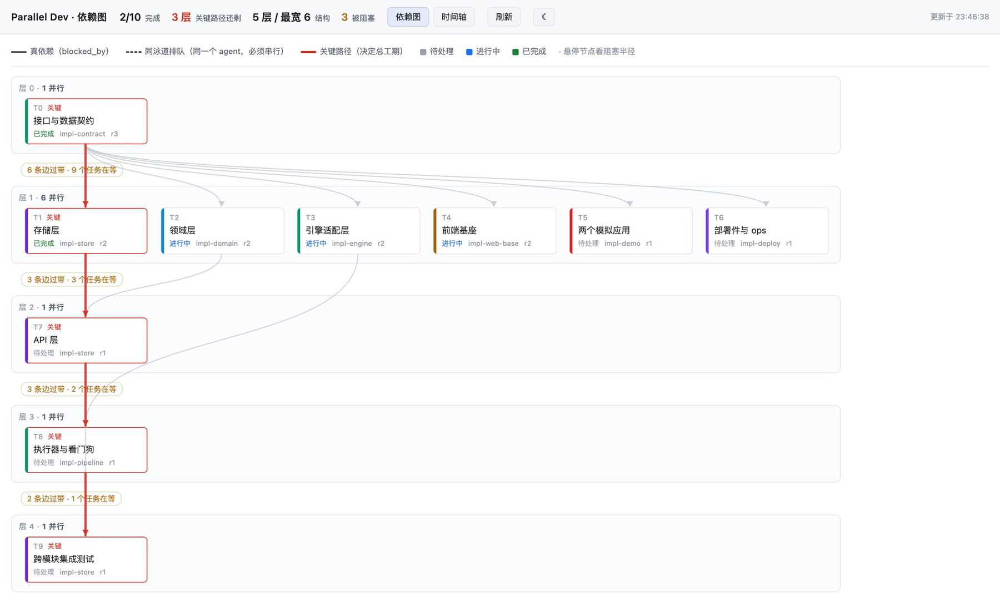

# dsh-parallel-dev

> 把「智能体团队模式并行开发」从建议变成**有门禁、可校验**的机制。

面向 [DeepSeek Harness](https://github.com/deepseek-ai/deepseek-harness) 的编排插件。它不重造任务板，只补上平台没做的那一件事：**把任务标记为「完成」时，必须有一份独立验收记录**。

- 门禁：`team_task_update(complete)` 没有验收记录会被真的拒绝，不是提示。
- 验收：记录绑定 commit sha；验收后代码再改动，完成动作照样被拒。
- 看板：依赖分层、关键路径、同泳道排队、并发时间轴，一眼看清「现在到哪了、卡在哪」。
- 设置页：在 DSH 设置里查看插件自身状态、诊断、安装信息，并配置 8 项行为。

当前版本：**v0.3.0**（实验性）。

---

## 目录

- [为什么需要它](#为什么需要它)
- [功能](#功能)
- [快速开始](#快速开始)
- [安装](#安装)
- [使用](#使用)
- [工具一览](#工具一览)
- [配置](#配置)
- [数据与命名空间](#数据与命名空间)
- [工作原理](#工作原理)
- [设置页](#设置页)
- [目录结构](#目录结构)
- [开发](#开发)
- [兼容性与已知限制](#兼容性与已知限制)
- [v0.3 变更](#v03-变更)
- [文档](#文档)
- [许可证](#许可证)

---

## 为什么需要它

平台已经提供了团队任务板（`team_task_create/list/get/update`）和完整的状态机。但它允许任何成员直接把任务标成 `completed` —— 没有验收、没有证据、没有独立核对。

「实施和验收是同一个人」是并行开发里最隐蔽的失败方式：看板全绿，交付物却没人独立看过。本插件用 `tools/pre-execute` 钩子拦截「标记完成」这个动作，把「验收通过」从模型的声称变成一个**能被机器校验、且能被强制**的状态。

## 功能

- **验收门禁**：`team_task_update` 的 `complete` 动作必须命中一份 `passed` 的验收记录，否则拒绝。
- **独立验收**：记录由一次性验收代理（`subagent`）登记，带逐条判据、可定位证据、验收方标识；实施方自己签字的记录会被拒（自证检查，默认开启，可在设置里放宽）。
- **提交绑定**：验收记录绑定 worktree 的 commit sha；完成时 HEAD 已变化 → 拒绝，因为验收过的版本已经不是交付的版本（默认开启，可在设置里放宽）。
- **用户豁免**：用户本人明确说「这个任务不用验收」时，`pdev_waive` 逐字核对用户原话后放行，并留痕。
- **依赖看板**：`/pdev/board`，纵向依赖图 + 关键路径 + 同泳道排队 + 并发时间轴；可嵌在 DSH 侧栏。
- **编排纪律注入**：自动把团队并行开发纪律写进系统提示，不依赖用户手动贴提示词。
- **设置页**：「并行开发配置」，查看插件状态 / 运行条件 / 安装信息 / 插件事件，配置 8 项行为（写入 profile 的 `cordis.patch.yml`）。



> 看板：5 层 / 最宽 6，红色为关键路径，紫色虚线为同泳道排队（`?demo=1` 演示数据）。

## 快速开始

1. 安装本插件并重启 DSH（见下一节）。
2. 让 Lead 在开工前调用 `pdev_preflight`，确认团队工具、git、项目占用都没问题。
3. 实施任务派 `spawn_teammate`，每个任务一个 worktree；完成后派一次性 `subagent` 验收，由它调 `pdev_verify_record`，再 `complete`。

## 安装

### 前置条件

| 项 | 说明 |
|---|---|
| DSH | 0.2.1-rc 系列（插件以 `@deepseek-ai/dsh-tools`、`@deepseek-ai/schemastery` 为运行时依赖） |
| Node.js | >= 20 |
| git | 命令行可用；验收记录要读 worktree 的 HEAD |
| Agent Teams | profile 需挂载 `@deepseek-ai/dsh-experimental-agent-team` 和 `@deepseek-ai/dsh-experimental-tool-agent-team`，否则团队工具不存在 |
| Web Server | 要看看板或设置页，profile 需挂载 `host-webserver`（`@deepseek-ai/dsh-host-webserver`） |
| Settings | 要在设置页里保存配置，profile 需挂载 `@deepseek-ai/dsh-settings` 服务；没有则设置页只读 |

> 缺 Agent Teams 时，插件仍会加载，但团队工具不可用，门禁没有可拦截的对象 —— 请先装团队包。

### 安装到 profile

把本仓库目录交给 DSH 会话里的 Agent，让它调用插件管理器：

```text
plugin_manager({
  action: "install_bundle",
  target: "/绝对路径/dsh-parallel-dev"
})
```

安装结果以返回的 `application` 字段为准；为 `applied` 后重启 DSH。

安装后无需手工改 `cordis.patch.yml`：本包自带的 `cordis.patch.yml` 会插入 `parallel-dev` 这一行。

卸载：从 profile `package.json` 的 `dsh.profile.bundles` 移除 `dsh-parallel-dev`，删除 `node_modules/dsh-parallel-dev`，重启 DSH。

### 验证安装

重启 DSH 后，在会话里调用：

```text
pdev_gate_status()
```

看到 `plugin: dsh-parallel-dev v0.3.0`、`gateInstalled: true` 即安装成功。
设置 → **并行开发配置** 也应出现；看板地址是 `/pdev/board`。

## 使用

### 1. 开工前

```text
pdev_preflight(project_root = "/path/to/project")
```

它会检查：团队工具是否真的存在、项目根是否被另一个编排会话占用、git 是否可用、已有验收记录覆盖情况。
返回的 `blockers` 不为空时**不要降级硬做** —— 先告诉用户。

### 2. 团队开发 + 独立验收

1. Lead 用 `team_task_create` 建任务，写清 `blocked_by` 和 `write_scopes`；第一层尽量做宽。
2. 实施任务用 `spawn_teammate`；每个实施任务一个独立 worktree + 分支。
3. 实施方完成后，Lead 派**一次性验收代理**（`subagent`）独立核对。
4. 验收代理调用 `pdev_verify_record` 登记记录（判据 + 证据 + commit sha）。
5. 实施方或 Lead 调 `team_task_update(action = "complete")`；门禁命中记录才放行。

没有验收记录的 `complete` 会被拒绝，并返回正确做法与所需参数。

### 3. 用户豁免

用户本人明确表示某任务不需要验收时：

```text
pdev_waive(task_id = "task-3", user_quote = "task-3 不用验收", reason = "文档改动")
```

插件会去本会话的用户消息里核对这句原话，并要求包含明确的豁免意思。编造的引用会被拒绝。
豁免会留痕，最终验收报告应列出所有豁免项。

### 4. 看板

- 浏览器打开 `/pdev/board`（拼在 DSH Web UI 地址后面）。
- 或在 DSH 侧栏打开「并行开发」面板：检测到未完成任务时会自动打开（可在设置页关闭）。
- 看板数据接口：`/pdev/board/data`，支持 `?session=<sessionId>` 与 `?demo=1`。

### 5. 设置页

设置 → **并行开发配置**：
查看插件版本、加载状态、5 个服务是否可用、安装目录 / profile / 配置文件 / 数据目录、插件提供的能力、最近插件事件；
配置 8 项行为并保存（写入当前 profile 的 `cordis.patch.yml`）。

## 工具一览

| 工具 | 作用 | 关键参数 |
|---|---|---|
| `pdev_preflight` | 开工前门禁检查 | `project_root?` |
| `pdev_verify_record` | 登记独立验收记录（完成任务的唯一凭据） | `task_id`、`commit_sha`、`worktree`、`verdict`、`verifier_id`、`evidence`、`criteria?`、`notes?`、`project_root?` |
| `pdev_waive` | 登记用户豁免（逐字核对用户原话） | `task_id`、`user_quote`、`reason?`、`project_root?` |
| `pdev_gate_status` | 查看门禁与验收记录，排查为什么被拒 | `project_root?` |
| `pdev_board` | 给出看板地址与依赖图摘要 | 无 |

`project_root` 省略时使用当前会话的 `session.header.cwd`。

## 配置

配置全局一份，存在当前 profile 的 `cordis.patch.yml`，由设置页写入；默认值全部保持最严格行为。

| 分组 | 配置 | 默认 | 作用 |
|---|---|---|---|
| 功能 | `injectPolicy` | 开 | 是否把编排纪律注入系统提示 |
| 功能 | `autoOpen` | 开 | 检测到未完成任务时自动打开侧栏看板 |
| 时间线 | `timelineEnabled` | 开 | 记录任务状态变更到 `.pdev/timeline.jsonl` |
| 时间线 | `timelineMaxEntries` | 60 | 内存中每个任务保留条数（10–500） |
| 门禁 | `gateMode` | `enforce` | `enforce` 拒绝；`advise` 只记录、不拒绝 |
| 门禁 | `requireEvidence` | 开 | 验收记录必须至少一条证据 |
| 门禁 | `requireCommitMatch` | 开 | 完成时 HEAD 必须等于验收记录的 sha |
| 门禁 | `blockSelfCertification` | 开 | 禁止任务所有者给自己登记验收 |

> 放宽 `gateMode` 或任一严格项会让「完成」的可信度下降；设置页会二次确认并显示警告。修改只在保存后生效，Host 读侧最多 1 秒缓存。

## 数据与命名空间

所有数据都在**项目根**下，可读、可 diff、可进版本库（默认建议把 `.pdev/` 加进 `.gitignore`）：

```text
<项目根>/.pdev/
├── verify/
│   ├── team-<leadId>__task-3.json           # 验收记录
│   └── team-<leadId>__task-7.waiver.json    # 用户豁免
└── timeline.jsonl                           # 任务状态变更（append-only）
```

验收记录按**团队**隔离：key 取团队 Lead 的会话 id；一次性验收 subagent 会归属到它所属的根会话，避免「记录落在 subagent 自己的命名空间里、Lead 找不到」。这样多个并行会话的同名 `task-1` 不会串。

## 工作原理

```text
Lead / teammate ──team_task_update(complete)──▶ tools/pre-execute 钩子
                                                  │
                          ┌───────────────────────┴───────────────────────┐
                          │ 用户豁免？                                    │ 放行
                          │ 验收记录存在且 passed？                       │
                          │ 记录 worktree 的 HEAD == commit_sha？         │
                          └───────────────────────┬───────────────────────┘
                                                  │ 任一不满足
                                                  ▼
                                              拒绝并说明原因
```

- 验收记录由 `pdev_verify_record` 写入，工具自己跑 `git rev-parse HEAD` 取证，不采信调用方转述。
- 验收方不能是任务所有者（默认开启；比对任务板 `ownerName` 与调用方成员）。
- `gateMode = enforce` 时拒绝；`advise` 时只打一行「仅提醒」并放行。

## 设置页

`src/client/client.js` 注册 `settings.section`（id `dsh-parallel-dev`，order 50，文案「并行开发配置」）。
页面是原生 React（不是 iframe），只展示**插件自身**的信息，不展示任务状态：

1. 插件状态（版本、加载时间、Host/Client 半边、门禁/提示词/看板）
2. 运行条件（tools / webServer / settings / systemPrompt / agentTeams，及缺失影响）
3. 安装信息（安装目录、profile、配置文件、数据目录、Node 版本）
4. 插件提供（5 个工具、看板路由、侧栏面板、提示词段）
5. 最近插件事件（最多 20 条，只记插件自身）
6. 配置表单（保存 / 恢复默认 / 只读兜底 / 冲突处理 / 放宽二次确认）
7. 复制诊断信息

配置接口：`GET /pdev/plugin/status`、`POST /pdev/plugin/config`（同源、JSON、修订号保护）。

## 目录结构

```text
dsh-parallel-dev/
├── src/
│   ├── host/
│   │   ├── index.js           # 插件入口：门禁、看板路由、工具注册、配置接线
│   │   ├── config.js          # 配置默认值 / 归一化 / 白名单校验（纯逻辑）
│   │   ├── config-schema.js   # schemastery Config（8 个 volatile 字段）
│   │   ├── gate-decision.js   # 门禁决策纯函数
│   │   ├── team-key.js        # 验收记录命名空间（含 subagent 归属修复）
│   │   ├── plugin-api.js      # /pdev/plugin/status、/pdev/plugin/config
│   │   ├── graph.js           # 依赖分层 / 关键路径 / 阻塞半径
│   │   ├── board-page.js      # 自包含看板 HTML + SVG
│   │   └── policy.js          # 注入系统提示的编排纪律
│   └── client/
│       └── client.js          # 侧栏看板面板 + 设置页（手写 React，无构建）
├── scripts/
│   ├── check-host.mjs         # Host 纯逻辑与 teamKey 行为测试
│   └── bsk-auto-browser.sh    # 开发期浏览器辅助
├── docs/                      # 设计契约、版本报告、看板快照与截图
├── cordis.patch.yml           # bundle 补丁：插入 parallel-dev 行
├── dev-sync.sh                # 开发同步到 profile
├── LICENSE
├── README.md
└── package.json
```

## 开发

```bash
# 语法检查（注意：node --check 一次传多个文件只会检查第一个）
for f in src/host/index.js src/host/config.js src/host/config-schema.js \
         src/host/gate-decision.js src/host/team-key.js src/host/plugin-api.js; do
  node --check "$f"
done
node --check src/client/client.js

# Host 纯逻辑测试（不依赖 node_modules）
node scripts/check-host.mjs

# 同步到本地 profile（macOS/Linux）
./dev-sync.sh desktop
```

- 没有构建步骤：Host 是普通 ESM；Client 是 `window.__ModuleLoader__` 工厂 + `React.createElement`。
- Host 改动要重启 DSH；Client 改动刷新页面即可。
- 所有配置字段都是 `.volatile()`：设置保存后即时生效，不重载插件。

## 兼容性与已知限制

- **实验性**：接口和行为可能随版本调整。
- **macOS 已验证**；Windows 未现场验证。Host 只用 Node API 和 `git` 子进程，理论上跨平台；开发脚本 `dev-sync.sh` 仅适用于 macOS/Linux。
- **单进程、共享 checkout**：这是 Agent Teams 的当前限制，插件不提供跨进程协调。
- **验收依赖 git**：项目不是 git 仓库时，`pdev_preflight` 会警告，提交绑定无法生效。
- **设置页依赖服务**：没有 `host-webserver` 时页面读不到状态；没有 `settings` 服务时只读。
- **豁免靠人**：`pdev_waive` 只能核对用户在本会话里说过的话，插件不判断任务是否真的该豁免。
- **界面中文**：v0.3 只做了中文文案。
- **记录不提供删除按钮**：避免给门禁开后门；需要清理时手工删 `.pdev/verify/` 下的文件。

## v0.3 变更

- 新增设置页「并行开发配置」（`settings.section`，order 50）。
- 新增 8 项配置，全部 volatile，写入 profile 的 `cordis.patch.yml`。
- 新增 `GET /pdev/plugin/status`、`POST /pdev/plugin/config`。
- 自动打开看板从 localStorage 迁移为配置（旧标记自动迁移，一次）。
- 修复：一次性验收 subagent 的验收记录归属到根会话，否则 Lead 的 `complete` 找不到记录。
- 版本升到 `0.3.0`。

## 文档

- [v0.3 接口与实现契约](docs/v0.3-contract.md)
- [v0.2 完成报告](docs/v0.2-report.md)
- [v0.1 完成报告](docs/v0.1-report.md)
- [v0.0 探针报告](docs/v0.0-probe-report.md)
- [看板静态快照](docs/board-snapshot.html)

## 许可证

本项目使用 **MIT** 许可证，详见 [LICENSE](LICENSE)。
